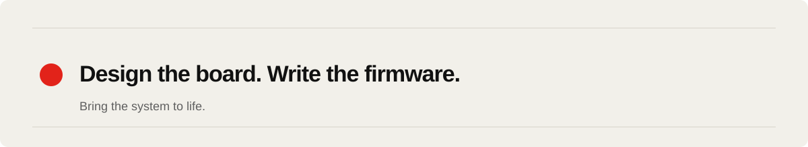

<p align="center">
  <picture>
    <source media="(prefers-color-scheme: dark)" srcset="./assets/swiss-poster-dark.svg">
    
  </picture>
</p>

# Evans Klenam Kwashie-Seyram

**Embedded Firmware & Hardware · UAV & Autonomous Systems**  
B.Sc. Computer Science · University of Cape Coast, Ghana · Expected May 2027

[LinkedIn](https://www.linkedin.com/in/evans-klenam-kwashie-seyram/) · [Portfolio](https://pcb-portfolio.vercel.app)

I build the electronics and firmware that make physical systems work. My work spans custom PCBs, microcontroller firmware, sensor interfaces and system bring-up — from schematic and layout through debugging and integration.

## Engineering focus

**Firmware**  
    

**Hardware**  
  

**Interfaces**  
    

## Highlights

### Boards

**01 · [UAV-PHMC](https://github.com/Evans-Kwashie/UAV-PHMC)**  
Four-layer STM32G071 payload-management controller with power monitoring, protected I/O, and UART and I²C interfaces.

**02 · [INA219 Voltage Sensing PCB](https://github.com/Evans-Kwashie/INA219-Voltage_Sensing_PCB)**  
Four-layer current and power-monitoring board with Kelvin-sense shunt routing and INA219 measurement.

### Firmware

**03 · [STM32C031 Bare-Metal Firmware](https://github.com/Evans-Kwashie/stm32c031-baremetal-firmware)**  
Register-level C firmware for STM32C031, including GPIO control, UART command handling and TIM3 interrupts.

**04 · [Tiny Tanks](https://github.com/Evans-Kwashie/Tiny-Tanks)**  
Dual-board real-time firmware paired with a custom 3D-printed snap-fit chassis.

## Team & community

- **OpenAMRobot** — Firmware and electrical lead, contributing STM32H723 board support, CubeMX configuration and the CMake/Ninja build setup.
- **UCC IoT / MicroPython** — ESP32-S3 Mini Pro board-support and bring-up work for IoT course demonstrations.
- **SAR Drone capstone** — Search-and-rescue quadcopter integration spanning flight-control electronics, mission computing, thermal imaging, GPS and LoRa telemetry.

## Currently learning

 

Building stronger foundations in RTOS architecture, embedded Linux and low-level systems software.

## Recent repository activity

<details>
<summary><sub>Latest public project updates · refreshed automatically</sub></summary>

<!-- LIVE:START -->
```text
$ ls ~/bench   # public projects, newest push first
mech-royale-bot              Python
UAV-PHMC                     STM32G071 drone payload controller with a ROS 2 digital twin
UART-2-RS-485-PCB            RS-485 converter with differential pairs and TVS protection
INA219-Voltage_Sensing_PCB   4-layer current and power monitor, Kelvin-sense shunt
CH340c-usb-uart-board        USB to UART board, first fully self-designed PCB
stm32c031-baremetal-firmware Bare-metal STM32C031 firmware in C featuring register-level pr
Gyroscope-Controlled-Car     MPU6050 hand-gesture RC car over ESP-NOW
Tiny-Tanks                   dual-board real-time firmware, 3D-printed snap-fit chassis
```
<sub>refreshed 2026-11-26 UTC by a scheduled workflow</sub>
<!-- LIVE:END -->

</details>

<p align="center">
  <picture>
    <source media="(prefers-color-scheme: dark)" srcset="./assets/swiss-closing-dark.svg">
    
  </picture>
</p>
