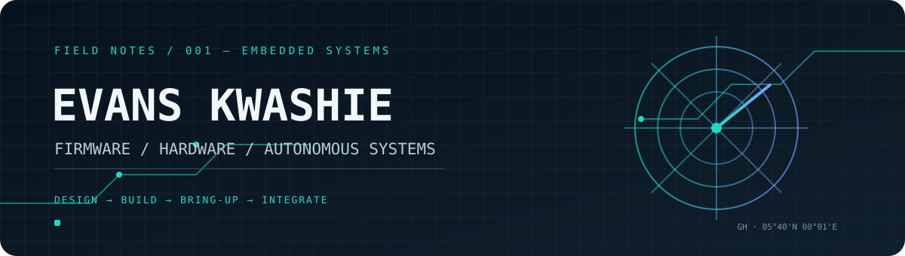

<div align="center">
  
</div>

<div align="center">
  <a href="https://github.com/Evans-Kwashie">GitHub</a> &nbsp;·&nbsp; <a href="https://www.linkedin.com/in/evans-klenam-kwashie-seyram/">LinkedIn</a> &nbsp;·&nbsp; <a href="https://pcb-portfolio.vercel.app">Portfolio</a>
</div>

## `01 / MISSION BRIEF`

I build the electronics and firmware behind physical systems — from a schematic and a blank microcontroller to a working board, a reliable interface, and an integrated machine. My focus is embedded firmware, custom hardware, sensing, motion and UAV systems.

**Embedded Firmware & Hardware · UAV & Autonomous Systems**  
B.Sc. Computer Science · University of Cape Coast, Ghana

```text
$ systemctl status evans
HARDWARE     ● online   KiCad / multilayer PCB / bring-up
FIRMWARE     ● online   C / C++ / STM32 / ESP32
INTERFACES   ● online   UART / I2C / SPI / RS-485 / BLE
RTOS         ◐ learning Zephyr / concurrency / message queues
EMBEDDED OS  ◐ learning Linux / low-level systems
```

## `02 / FLIGHT & CONTROL`

| PROJECT | BUILD NOTES |
|:--|:--|
| [**UAV-PHMC**](https://github.com/Evans-Kwashie/UAV-PHMC) | 4-layer STM32G071 payload-management and health-monitoring controller; power monitoring, protected I/O and system interfaces |
| **SAR Drone** · team capstone | Search-and-rescue quadcopter concept integrating flight-control electronics, mission computing, thermal imaging, GPS and LoRa telemetry |


## `03 / HARDWARE BUILDS`

| PROJECT | ENGINEERING FOCUS |
|:--|:--|
| [**INA219 Voltage Sensing PCB**](https://github.com/Evans-Kwashie/INA219-Voltage_Sensing_PCB) | 4-layer current and power-monitoring board; Kelvin-sense shunt routing |
| [**UART-2-RS-485-PCB**](https://github.com/Evans-Kwashie/UART-2-RS-485-PCB) | Differential serial interface with TVS protection |
| [**CH340C USB-to-UART**](https://github.com/Evans-Kwashie/CH340c-usb-uart-board) | USB-to-UART interface; first fully self-designed PCB |

## `04 / FIRMWARE & MOTION`

| PROJECT | ENGINEERING FOCUS |
|:--|:--|
| [**Gyroscope-Controlled-Car**](https://github.com/Evans-Kwashie/Gyroscope-Controlled-Car) | MPU6050 hand-orientation sensing and ESP-NOW control |
| [**ESP32 Air Mouse**](https://github.com/Evans-Kwashie/Esp32-Air-Mouse) | Kalman-filtered IMU data streamed as a BLE HID device |
| [**Tiny Tanks**](https://github.com/Evans-Kwashie/Tiny-Tanks) | Dual-board real-time firmware and a 3D-printed snap-fit chassis |

## `05 / ENGINEERING STACK`

| DOMAIN | TOOLS & TECHNOLOGIES |
|:--|:--|
| **Firmware** | C · C++ · MicroPython · STM32 HAL · ESP-IDF |
| **Platforms** | STM32 · ESP32 · RP2040 |
| **Embedded** | GPIO · interrupts · timers · PWM · DMA · UART · I²C · SPI |
| **Connectivity** | RS-485 · BLE · ESP-NOW · Wi-Fi · LoRa |
| **Hardware** | KiCad · schematic capture · multilayer PCB layout · DRC · bring-up |
| **Tooling** | Git · Linux · VS Code · CMake · GDB |

## `06 / CURRENT FLIGHT PLAN`

- Developing firmware and payload electronics for a search-and-rescue UAV.
- Learning Zephyr RTOS through threads, message queues and application design.
- Strengthening embedded Linux and low-level systems foundations.

```text
~/workbench $ ls
UAV-PHMC/  INA219-Voltage_Sensing_PCB/  UART-2-RS-485-PCB/
Gyroscope-Controlled-Car/  Tiny-Tanks/  Esp32-Air-Mouse/
```

<div align="center">
  <sub>MAKE THE HARDWARE REAL. MAKE THE FIRMWARE RELIABLE.</sub>
</div>
