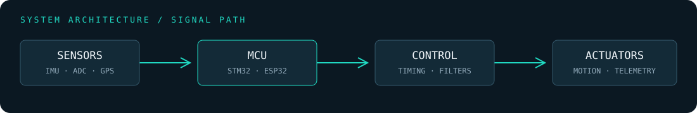

  <picture>
    <source media="(prefers-color-scheme: light)" srcset="assets/hero-light.svg">
    
  </picture>

  <a href="https://www.linkedin.com/in/evans-klenam-kwashie-seyram/">LinkedIn</a>
  &nbsp;·&nbsp;
  <a href="https://pcb-portfolio.vercel.app">Hardware Portfolio</a>
  &nbsp;·&nbsp;
  <a href="https://github.com/Evans-Kwashie">GitHub</a>

# Evans Kwashie
### Embedded Firmware & Hardware · UAV & Autonomous Systems

I build the electronics and firmware behind physical systems — from circuit design and PCB layout to peripheral bring-up, low-level drivers and system integration.

I'm a Computer Science student at the **University of Cape Coast, Ghana**, focused on embedded C/C++, microcontrollers, custom hardware and autonomous systems.

---

## 01 / Selected engineering work

| PROJECT | WHAT I BUILT |
|:--|:--|
| [**UAV-PHMC**](https://github.com/Evans-Kwashie/UAV-PHMC) | Custom four-layer STM32G071-based UAV controller hardware. Includes power monitoring, protected I/O, UART/I²C/RS-485 interfaces, BOM, Gerbers, pick-and-place data and a 3D PCB model. |
| [**STM32C031 Bare-Metal Firmware**](https://github.com/Evans-Kwashie/stm32c031-baremetal-firmware) | Register-level C with CMSIS: GPIO, TIM3 interrupts and a USART1 command interface. CMake + GNU Arm toolchain, with a NUCLEO-C031C6 Wokwi setup. |
| [**INA219 Voltage Sensing PCB**](https://github.com/Evans-Kwashie/INA219-Voltage_Sensing_PCB) | Four-layer current and power-monitoring board with Kelvin-sense shunt routing, analogue filtering and I²C. |
| [**UART-to-RS-485 PCB**](https://github.com/Evans-Kwashie/UART-2-RS-485-PCB) | Differential serial interface hardware with protection for field communication. |
| [**CH340C USB-to-UART**](https://github.com/Evans-Kwashie/CH340c-usb-uart-board) | USB-to-UART interface board and an early end-to-end schematic-to-PCB build. |
| [**ESP32 Air Mouse**](https://github.com/Evans-Kwashie/Esp32-Air-Mouse) | Wearable BLE HID mouse using MPU6050 motion sensing, Kalman filtering and gesture-based input. |
| [**Gyroscope-Controlled Car**](https://github.com/Evans-Kwashie/Gyroscope-Controlled-Car) | Motion-controlled vehicle using IMU orientation and ESP-NOW communication. |
| [**Tiny Tanks**](https://github.com/Evans-Kwashie/Tiny-Tanks) | Dual-board embedded control project paired with a 3D-printed chassis. |

> **UAV-PHMC status:** the repository contains the KiCad design and generated manufacturing outputs. Fabrication, assembly and flight validation are not claimed.

## 02 / Engineering workflow

I enjoy working across the hardware/software boundary:

`SPEC → SCHEMATIC → PCB LAYOUT → BRING-UP → FIRMWARE → INTEGRATION`

  

| AREA | EXPERIENCE & TOOLS |
|:--|:--|
| **Firmware** | C · C++ · Embedded C · MicroPython · CMSIS · STM32 HAL |
| **MCUs** | STM32 · ESP32 · RP2040 |
| **Peripherals** | GPIO · interrupts · timers · PWM · UART · I²C · SPI · DMA |
| **Connectivity** | RS-485 · BLE · ESP-NOW · Wi-Fi · LoRa |
| **Hardware** | KiCad · schematic capture · multilayer PCB layout · DRC · board bring-up |
| **Build & debug** | CMake · Ninja · GNU Arm GCC · GDB · Git · Linux |

## 03 / Current workbench

- **Zephyr RTOS** — learning threads, scheduling, message queues and driver/application structure through hands-on projects.
- **Embedded Linux** — building foundations in Linux internals, boot flow and low-level systems.
- **Bare-metal STM32** — strengthening register-level peripheral control and understanding what happens beneath vendor HALs.
- **UAV electronics** — developing practical experience in power distribution, sensing, interfaces and hardware integration.

## 04 / Beyond the bench

I'm also part of a team developing a **search-and-rescue UAV concept**, bringing together flight-control electronics, mission computing, thermal imaging, GPS and telemetry.

I value engineering that can be inspected, built, measured and debugged — not just code that compiles.

---

  **DESIGN THE HARDWARE. UNDERSTAND THE FIRMWARE. MAKE THE SYSTEM WORK.**
    
  <a href="https://github.com/Evans-Kwashie">GitHub</a>
  &nbsp;·&nbsp;
  <a href="https://www.linkedin.com/in/evans-klenam-kwashie-seyram/">LinkedIn</a>
  &nbsp;·&nbsp;
  <a href="https://pcb-portfolio.vercel.app">Portfolio</a>

