<!-- if you are reading the source: hello. let's build something that flies. -->
<div align="center">



</div>

### `$ ./boot --profile evans`

```text
[  OK  ] Hardware    schematic capture, 4-layer PCB layout, differential pairs, sensing front-ends
[  OK  ] Firmware    C, C++, MicroPython on STM32, ESP32 and RP2040
[  OK  ] Wireless    ESP-NOW, BLE HID, LoRa telemetry
[  OK  ] UAV         flight controllers, payload electronics, ROS 2 digital twins
[ RUN  ] Mission     low-cost modular search-and-rescue drone (team capstone)
```

I design the board, write the firmware that runs on it, and debug the two together. My work sits where electronics meets flight: custom PCBs, sensor pipelines, and the embedded software that keeps a vehicle in the air.

<div align="center">



</div>

---

### 🛰️ Flight and UAV

| Project | What it is |
|---|---|
| [**UAV-PHMC**](https://github.com/Evans-Kwashie/UAV-PHMC) | Modular 4-layer payload management and health controller for a lightweight drone, built on an STM32G071 with a ROS 2 digital twin |
| **SAR Drone** (in progress) | Team capstone: F450 quadcopter, STM32F405 flight controller, ESP32 mission computer, thermal camera, GPS and LoRa telemetry feeding a live rescue dashboard |

<div align="center">



</div>

### 🔌 Custom boards

| Board | What it does |
|---|---|
| [**INA219 Voltage Sensing PCB**](https://github.com/Evans-Kwashie/INA219-Voltage_Sensing_PCB) | 4-layer current and power monitor with Kelvin-sense shunt routing |
| [**UART to RS-485**](https://github.com/Evans-Kwashie/UART-2-RS-485-PCB) | Differential-pair RS-485 converter with TVS protection |
| [**CH340C USB to UART**](https://github.com/Evans-Kwashie/CH340c-usb-uart-board) | First fully self-designed board, USB data lines to UART |

### 🤖 Firmware and motion control

| Project | What it does |
|---|---|
| [**Gyroscope-Controlled Car**](https://github.com/Evans-Kwashie/Gyroscope-Controlled-Car) | MPU6050 hand-orientation sensing drives an RC car over ESP-NOW with low latency |
| [**ESP32 Air Mouse**](https://github.com/Evans-Kwashie/Esp32-Air-Mouse) | Wearable air mouse: Kalman-filtered IMU data sent as a BLE HID device |
| [**Tiny Tanks**](https://github.com/Evans-Kwashie/Tiny-Tanks) | Dual-board real-time firmware project with a 3D-printed snap-fit chassis |

---

### 🧰 Toolbox

<div align="center">


</div>

**Interfaces:** UART · RS-485 · I2C sensing · ESP-NOW · BLE · LoRa  
**Hardware craft:** multi-layer PCB design · differential routing · TVS protection · Kelvin sensing · 3D-printed enclosures

---

### 🎯 Now

- Bringing up flight-controller firmware for the search-and-rescue drone
- Building out payload electronics and telemetry for lightweight UAVs
- Learning in public: every board and firmware project here started as a self-taught build
